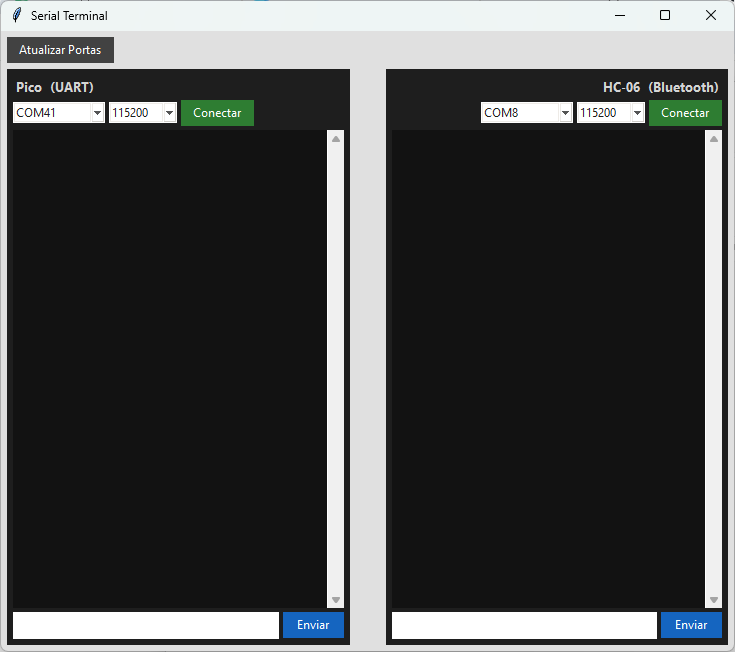

# Ponte serial HC-06 com Raspberry Pi Pico 2 e FreeRTOS

Este projeto implementa uma ponte serial bidirecional entre um computador e um
módulo Bluetooth HC-06 usando uma Raspberry Pi Pico 2:

```text
PC ── Pico Debug Probe/UART0 ── Pico 2 ── UART1 ── HC-06 ── Bluetooth
```

O firmware também configura automaticamente módulos novos em 9600 baud para
operarem em 115200 baud.

## Hardware suportado

- Raspberry Pi Pico 2 (`pico2`, RP2350 ARM Cortex-M33).
- Pico Debug Probe para gravação SWD e terminal serial.
- HC-06 com firmware `HC-06-20190901`.
- Pico SDK 2.3.0 e GCC ARM 15.2.1.

O firmware consulta `AT+VERSION` antes de alterar o módulo. Uma versão diferente
é informada como incompatível e não recebe comandos de configuração.

## Ligações

### HC-06 → Pico 2

| HC-06 | Pico 2 | Pino físico | Observação |
|---|---|---:|---|
| RXD | GP4 / UART1 TX | 6 | Entrada lógica de 3,3 V |
| TXD | GP5 / UART1 RX | 7 | Saída lógica de 3,3 V |
| GND | GND | 8 | Terra comum obrigatório |
| VCC | VBUS / 5 V | 40 | Alimentação do breakout |

`STATE` e `EN/KEY` não são utilizados.

```text
HC-06 RXD  <── GP4 (TX1)
HC-06 TXD  ──> GP5 (RX1)
HC-06 GND  ─── GND
HC-06 VCC  <── VBUS 5 V
```

### Pico Debug Probe → Pico 2

Além das conexões SWD, conecte a UART do Debug Probe à UART0 da Pico:

```text
Debug Probe UART RX  <── Pico GP0 (TX0)
Debug Probe UART TX  ──> Pico GP1 (RX0)
Debug Probe GND      ─── Pico GND
```

O terminal deve usar `115200, 8N1`, sem controle de fluxo e sem final de linha
automático para testes AT.

## Configuração automática do HC-06

Na inicialização, o firmware:

1. Aguarda 5 segundos para o HC-06 completar o boot.
2. Procura o módulo primeiro em 115200 baud.
3. Faz até três tentativas, com 5 segundos entre elas.
4. Se necessário, repete o teste em 9600 baud.
5. Consulta `AT+VERSION` e exige `HC-06-20190901`.
6. Se o módulo estiver em 9600, envia `AT+BAUD8` e muda para 115200.
7. Configura nome e PIN.
8. Inicia a ponte serial usando FreeRTOS.

Os comandos são enviados sem `CR`, `LF` ou `CR+LF`, conforme exigido pelo
firmware validado:

```text
AT
AT+VERSION
AT+BAUD8
AT+NAMELAB-EXPERT-BT
AT+PIN1234
```

Nome e PIN são definidos em `main/main.c`:

```c
#define HC06_NAME "LAB-EXPERT-BT"
#define HC06_PIN  "1234"
```

## Arquitetura FreeRTOS

- `uart_rx_handler`: recebe bytes pela UART1 e os coloca em `xQueueRX` a partir
  da interrupção.
- `serial_task`: encaminha `xQueueRX` ao terminal do Debug Probe e coloca os
  caracteres digitados no terminal em `xQueueTX`.
- `tx_task`: retira bytes de `xQueueTX` e os transmite ao HC-06.

## Teste e diagnóstico

Um módulo configurado deve responder em um terminal USB-UART configurado para
115200 baud e sem final de linha:

```text
> AT
OK
> AT+VERSION
HC-06-20190901
```

Se não houver resposta:

1. Confirme que GP4/GP5 são GPIOs, não os pinos físicos 4/5.
2. Confirme RX/TX cruzados e GND comum.
3. Desconecte qualquer outro transmissor da linha RXD do HC-06.
4. Confirme que não existe conexão Bluetooth ativa durante os comandos AT.
5. Aguarde pelo menos 5 segundos entre tentativas.

Um CP210x pode ser usado como observador, conectando apenas `RXD` e `GND` à
linha que será monitorada. Não conecte dois TXs simultaneamente à mesma entrada.

## Terminal Python

A pasta `python` contém uma interface gráfica com dois terminais independentes:

- **Pico (UART):** porta serial do Pico Debug Probe. Ela exibe as mensagens de
  inicialização, configuração e diagnóstico produzidas pela Pico 2.
- **HC-06 (Bluetooth):** porta COM criada pelo sistema operacional depois do
  pareamento. Ela representa o canal Bluetooth de dados do HC-06.

As duas portas devem operar em 115200 baud depois que a configuração automática
do módulo for concluída.

### Instalação

```powershell
pip install pyserial
```

### Execução

Execute o programa a partir da pasta `python`, pois as últimas portas escolhidas
são armazenadas no arquivo `settings.json` dessa pasta:

```powershell
cd python
python terminal.py
```

### Utilização

1. Clique em **Atualizar Portas**.
2. No painel esquerdo, selecione a COM do Pico Debug Probe.
3. No painel direito, selecione a COM Bluetooth criada pelo pareamento do HC-06.
4. Configure os dois painéis para 115200 baud.
5. Clique em **Conectar** nos dois painéis.
6. Envie uma mensagem por um painel e confira sua chegada no outro.

Não é possível abrir a mesma porta simultaneamente no terminal Python e no
Serial Monitor do VS Code. Clique em **Stop Monitoring** antes de conectar o
programa Python à COM do Debug Probe.

O recurso **Spam** transmite palavras periodicamente e pode ser usado para
testar comunicação contínua, filas e perda de bytes. Comece com um intervalo
alto e reduza gradualmente durante o teste.



## Referência

- [Manual do HC-06](https://www.olimex.com/Products/Components/RF/BLUETOOTH-SERIAL-HC-06/resources/hc06.pdf)
